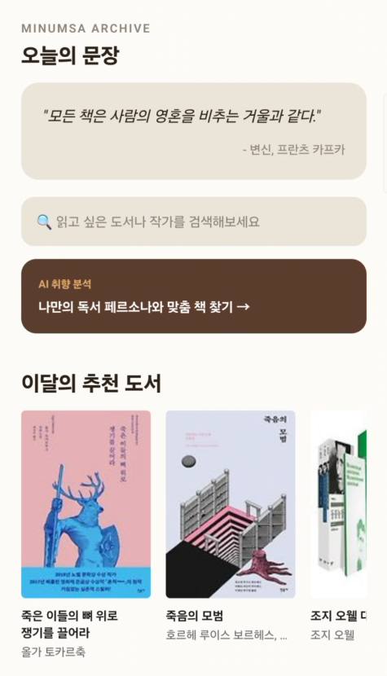
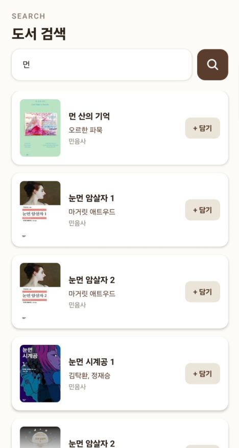
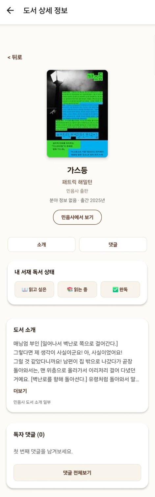
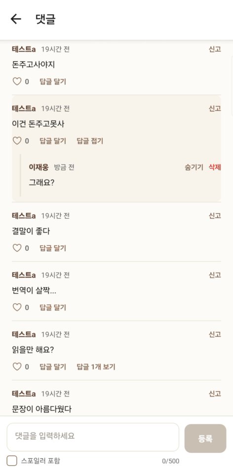
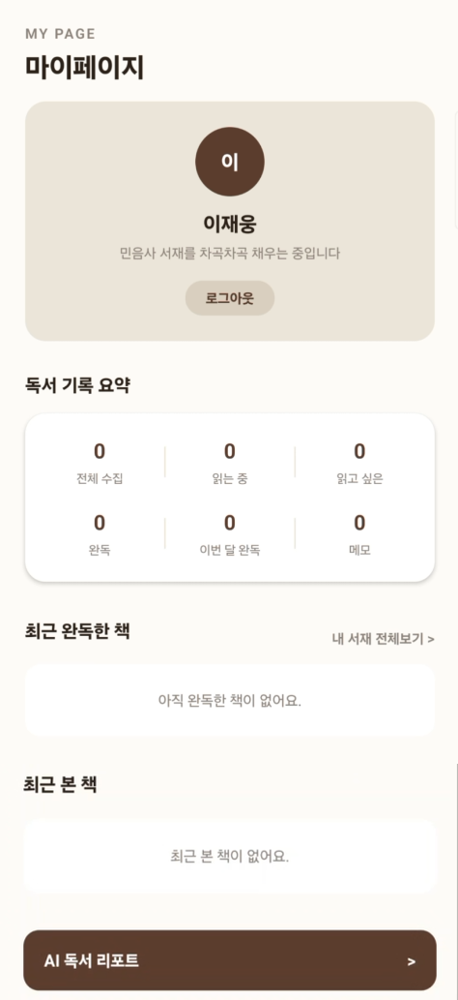
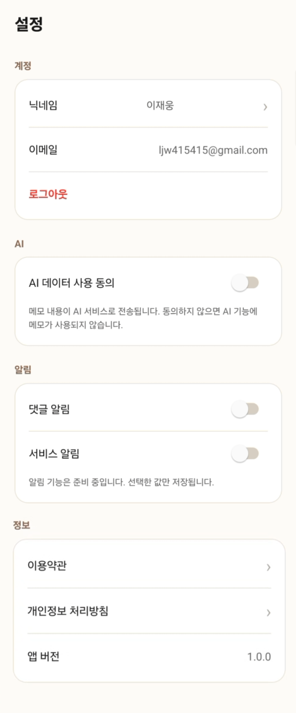
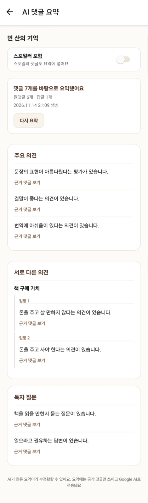
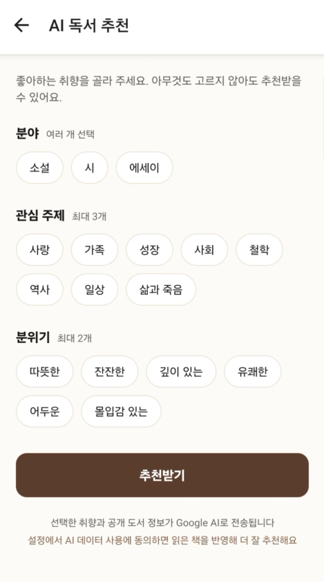
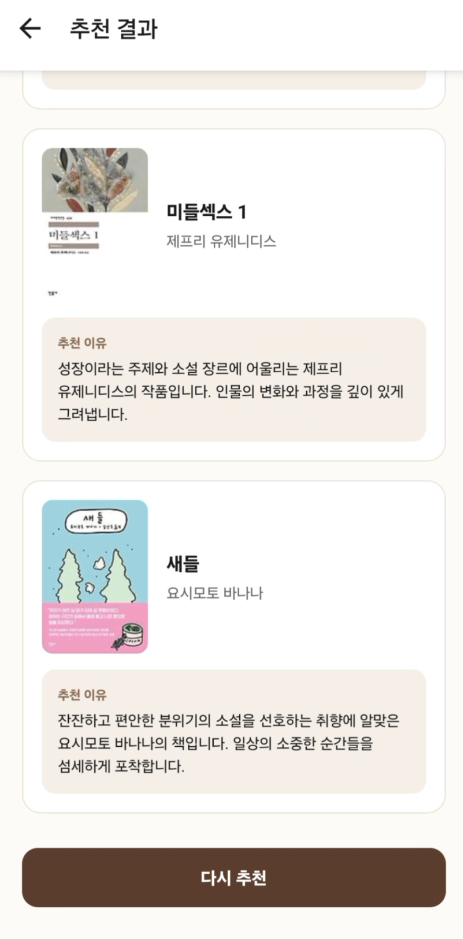
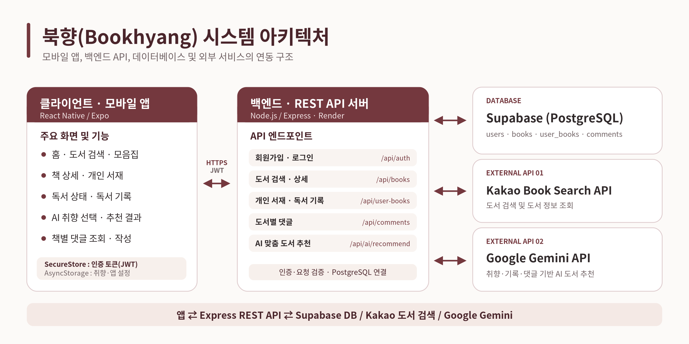

<p align="center">
  
</p>

<h2 align="center">북향 (Bookhyang)</h2>

<p align="center">
  <b>민음사 감성의 개인 독서와 단체 아카이빙 & AI 기반 독서 분석 모바일 어플리케이션</b>
</p>

<p align="center">
  26.09.02~ now · 북향 · 민음사 아카이브
</p>

<!-- 기술 스택 배지를 추가할 위치 -->

---

## Overview

| 항목 | 내용 |
| --- | --- |
| 서비스 목표 | 개인의 독서를 기록하고 타인과의 생각을 나누며 AI를 기반으로 한 독서 리포트로 자신의 취향 확립과 독서 추천 |
| 핵심 흐름 | 회원가입·로그인 → 도서 탐색(검색·모음집) → 도서 상세 조회 → 개인 서재 저장 및 독서 기록 관리 → AI 맞춤 도서 추천 → 책별 댓글을 통한 독서 경험 공유 |
| 차별점 | 기존 독서 어플과 달리 댓글 기능과 AI도입으로 추천과 요약을 하며 커뮤니티 기능으로 공통 관심사 모임을 생성 및 참가 가능 |
| 주요 사용자 | 민음사의 관심을 가져 독서를 입문하고 싶은 입문자부터 메이저, 마이너 문학인 모두가 대상 |
| 사용자 가치 | 도서 탐색부터 개인 서재 관리, 독서 경험 공유까지 하나의 공간에서 연결하여 사용자가 자신의 독서 활동을 체계적으로 기록하고, 다양한 독자의 관점을 통해 독서 경험을 확장할 수 있도록 지원 |
| 개발 기간 | 26.09.02 ~ 26.12.02 |

---

## 1. 프로젝트 소개

북향(Bookhyang)은 AI 기반 도서 추천과 독자 간 커뮤니티 기능을 결합한 개인 맞춤형 독서 아카이빙 애플리케이션입니다.

기존의 도서 검색 및 기록 중심 서비스에서 나아가, 사용자의 독서 취향과 활동을 분석하여 개인에게 적합한 도서를 추천하고, 같은 책을 읽은 독자들이 서로의 생각과 감상을 공유할 수 있는 독서 환경을 제공하는 것을 목표로 합니다.

사용자는 도서를 검색하고, 관심 있는 책을 개인 서재에 저장하며, 읽고 싶은 책부터 완독한 책까지 독서 상태를 체계적으로 관리할 수 있습니다.

특히 북향은 다음 두 가지 기능을 핵심 차별점으로 삼고 있습니다.

### 1. AI 기반 개인 맞춤형 독서 지원

사용자의 독서 기록과 취향을 기반으로 관심사에 적합한 도서를 추천하고, AI를 활용한 도서 요약 및 브리핑 기능을 통해 새로운 책을 더욱 쉽고 효율적으로 탐색할 수 있도록 지원합니다.

### 2. 독자 중심 커뮤니티

도서별 댓글과 대댓글을 통해 같은 책을 읽은 사용자들이 자유롭게 의견을 교환하고, 서로 다른 해석과 감상을 공유할 수 있는 소통 공간을 제공합니다. 나아가 독서 모임 등 커뮤니티 기능을 확장하여 개인적인 독서 활동을 사회적 경험으로 연결하고자 합니다.

북향은 단순히 책을 검색하고 기록하는 애플리케이션을 넘어, AI를 통해 새로운 책을 발견하고, 커뮤니티를 통해 독서의 깊이를 넓히는 통합 독서 플랫폼을 지향합니다.

---

## 2. 시연 화면

### 대표 시연 화면

<p align="center">
  
</p>

### 주요 화면

| 홈 화면 | 모음집 화면 | 검색 화면 |
| :---: | :---: | :---: |
|  |  |  |
| 주요 도서 콘텐츠와 서비스 기능을 확인할 수 있는 메인 화면 | 도서를 한눈에 살펴보고 원하는 책을 탐색하는 화면 | 도서명과 저자명을 이용해 원하는 책을 검색하는 화면 |

| 책 상세 화면 | 책별 댓글 화면 | 로그인 화면 |
| :---: | :---: | :---: |
|  |  |  |
| 책의 기본 정보와 소개, 독서 상태 및 독자 댓글을 확인하는 화면 | 같은 책을 읽은 독자들의 감상과 의견을 공유하는 화면 | 이메일과 비밀번호를 이용해 사용자 계정에 로그인하는 화면 |

| MY 화면 | 설정 화면 | 공통 UI |
| :---: | :---: | :---: |
|  |  |  |
| 개인 서재와 독서 상태 별 통계, 최근 등록한 도서를 관리하는 화면 | 계정 정보와 알림, AI 데이터 활용 동의 등을 관리하는 화면 | 하단 내비게이션과 통일된 디자인을 통해 화면 간 이동을 지원하는 UI |

| AI 댓글 요약 | AI 독서 추천 | 추천 결과 |
| :---: | :---: | :---: |
|  |  |  |
| 도서별 독자 댓글의 핵심 의견을 AI로 요약하여 제공하도록 설계한 화면 | 선호 분야와 관심 주제, 작품 분위기를 선택하는 AI 추천 화면 | 사용자 취향에 맞는 도서와 추천 이유를 제공하도록 구성한 화면 |

### 화면별 시연 내용

| 화면 | 시연 내용 |
| --- | --- |
| 홈 | 앱 실행 후 표시되는 메인 화면으로, 주요 도서 콘텐츠를 확인하고 하단 내비게이션을 통해 모음집, 검색, MY, 설정 등 주요 기능으로 이동할 수 있다. |
| 모음집 | 도서를 목록 형태로 탐색하는 화면이다. 도서 표지와 제목 등 기본 정보를 확인하고, 관심 있는 도서를 선택하여 상세 정보를 조회할 수 있도록 구성하였다. |
| 검색 | 카카오 도서 검색 API를 활용하여 도서 제목과 저자명을 기준으로 책을 검색한다. 검색 결과에는 도서 표지, 제목, 저자 등의 정보가 표시되며, 원하는 도서를 선택하면 상세 화면으로 이동할 수 있다. |
| 책 상세 | 선택한 도서의 표지, 제목, 저자, 출판사 및 소개 정보를 확인할 수 있다. 로그인한 사용자는 도서를 개인 서재에 등록하고 읽고 싶은 책, 읽는 중, 완독 상태로 구분하여 관리할 수 있다. 또한 해당 도서의 최근 댓글과 전체 댓글 목록으로 이동하는 기능을 제공한다. |
| 책별 댓글 | 도서별로 구분된 댓글 공간에서 다른 독자들의 감상과 의견을 확인할 수 있다. 로그인한 사용자는 새로운 댓글을 작성하거나 본인이 작성한 댓글을 삭제할 수 있으며, 최신순 조회와 추가 불러오기 기능을 지원한다. 좋아요, 대댓글 및 신고 기능은 향후 확장할 예정이다. |
| 로그인 | 이메일과 비밀번호를 이용하여 회원가입 및 로그인을 진행한다. JWT 기반 인증으로 로그인 상태를 유지하며, 인증이 필요한 개인 서재 및 댓글 작성 기능에 접근할 수 있다. 로그아웃과 인증 만료 처리 기능도 지원한다. |
| MY | 사용자가 저장한 도서를 개인 서재에서 관리하는 화면이다. 전체 수집 도서 수와 독서 상태별 통계를 확인하고, 최근 등록한 도서를 조회할 수 있다. 도서의 독서 상태 변경 및 서재에서 삭제하는 기능을 제공한다. |
| 설정 | 계정 정보, 애플리케이션 버전, 댓글 및 서비스 알림 설정 등을 확인하고 관리한다. AI 추천에 필요한 데이터 활용 동의 여부를 설정할 수 있으며, 이용약관과 개인정보 처리방침 화면으로 이동할 수 있다. |
| AI 댓글 요약 | 특정 도서에 작성된 독자 댓글을 AI로 분석하여 주요 의견과 공통적으로 나타나는 감상을 요약하는 기능을 목표로 한다. 여러 댓글을 개별적으로 읽지 않아도 독자들의 다양한 관점을 빠르게 파악할 수 있도록 설계한 기능이다. |
| AI 독서 추천 | 사용자가 선호하는 도서 분야, 관심 주제, 작품 분위기 등을 선택하면 Google Gemini API를 활용하여 취향에 맞는 도서를 추천하도록 설계하였다. 사용자 동의 시 기존 독서 기록과 도서별 댓글을 추천 데이터로 활용하는 구조를 고려하였다. |
| 추천 결과 | AI가 분석한 사용자 취향을 기반으로 최대 3권의 도서와 각 도서의 추천 이유를 표시하도록 구성하였다. 추천 결과를 통해 사용자가 새로운 책을 발견하고 독서 선택의 폭을 넓히는 것을 목표로 한다. 재 추천 기능도 제공한다. |


---

## 3. 주요 기능

### 도서 검색 및 상세 정보 조회

- 카카오 도서 검색 API를 활용하여 도서 제목과 저자명 기반의 검색 기능을 제공합니다.
- 검색 결과에서 도서 표지, 제목, 저자, 출판사 등의 기본 정보를 확인할 수 있습니다.
- 도서 선택 시 상세 화면으로 이동하여 책 소개 및 독서 상태를 확인할 수 있습니다.
- 검색 결과에서 독서 상태를 선택하여 개인 서재에 도서를 등록할 수 있습니다.

### 개인 서재 및 독서 기록 관리

- 관심 있는 도서를 개인 서재에 저장하고 관리할 수 있습니다.
- 도서별 독서 상태를 `읽고 싶은 책(WISH)`, `읽는 중(READING)`, `완독(COMPLETED)`으로 구분합니다.
- 저장된 도서의 독서 상태를 변경하거나 서재에서 삭제할 수 있습니다.
- 독서 상태별 필터링을 통해 원하는 도서 목록을 확인할 수 있습니다.
- 마이페이지에서 전체 수집 도서 수와 상태별 독서 통계, 최근 등록한 도서를 확인할 수 있습니다.

### AI 기반 개인 맞춤형 도서 추천

**북향의 핵심 차별화 기능으로, 사용자의 독서 취향과 활동을 활용한 AI 도서 추천을 제공합니다.**

- Google Gemini API를 활용한 도서 추천 시스템을 개발하고 있습니다.
- 사용자는 선호하는 도서 분야, 관심 주제, 작품 분위기를 선택할 수 있습니다.
- 선택한 취향을 바탕으로 최대 3권의 도서와 추천 이유를 제공합니다.
- 사용자 동의 시 기존 독서 기록을 추천에 반영할 수 있도록 설계했습니다.
- 도서별 독자 댓글을 추천 판단의 참고 데이터로 활용하는 구조를 구현했습니다.
- 추천 결과를 다시 생성하는 기능과 API 오류 처리 기능을 제공합니다.
- 현재 AI 취향 선택, 추천 결과 UI 및 백엔드 추천 로직을 구현했으며, 실제 서비스 연동과 안정화 작업을 진행하고 있습니다.

### 도서별 독자 댓글

**같은 책을 읽은 사용자들이 감상과 생각을 공유할 수 있는 소통 기능입니다.**

- 도서별로 독립된 댓글 공간을 제공합니다.
- 책 상세 화면에서 최근 댓글과 전체 댓글 수를 확인할 수 있습니다.
- 댓글 전체보기 화면에서 독자들의 의견을 확인하고 새로운 댓글을 작성할 수 있습니다.
- 본인이 작성한 댓글을 삭제할 수 있습니다.
- 댓글은 ISBN13을 기준으로 도서와 연결되며, 최신순 목록과 추가 불러오기를 지원합니다.

### 사용자 인증 및 계정 관리

- 이메일과 비밀번호를 이용한 회원가입 및 로그인 기능을 제공합니다.
- JWT 기반 사용자 인증을 적용하여 계정별 데이터를 관리합니다.
- 로그인 토큰을 기기에 안전하게 저장하고 로그인 상태를 유지합니다.
- 로그아웃 및 인증 만료 처리 기능을 제공합니다.
- 사용자별 개인 서재와 독서 기록을 분리하여 관리합니다.

### 환경 설정

- 계정 정보 및 애플리케이션 버전 확인 기능을 제공합니다.
- AI 데이터 사용 동의 여부를 설정하고 저장할 수 있습니다.
- 댓글 및 서비스 알림 설정값을 관리할 수 있습니다.
- 이용약관과 개인정보 처리방침 화면을 제공합니다.

### 독서 커뮤니티 (개발 예정)

**개인의 독서 기록을 넘어 다른 독자와의 교류를 확대하기 위한 핵심 차별화 기능입니다.**

- 공통 관심사를 가진 사용자들이 독서 모임을 생성하고 참여할 수 있는 커뮤니티를 구축할 계획입니다.
- 독서 모임을 중심으로 책에 대한 의견과 감상을 자유롭게 공유할 수 있는 환경을 제공하고자 합니다.
- 게시글, 댓글, 사용자 간 상호작용 기능을 통해 독서 경험을 확장할 예정입니다.
- 현재 커뮤니티 탭과 안내 화면을 구성했으며, 실제 커뮤니티 기능은 향후 구현할 계획입니다.

---

## 4. 기술 스택

| 영역 | 기술 |
| --- | --- |
| Frontend | React Native (Expo SDK 58), JavaScript, axios |
| Backend | Node.js, Express |
| Database | Supabase (PostgreSQL), `pg`로 직접 연결 |
| Navigation / State | React Navigation (하단 탭 + 스택), React Context (AuthContext), AsyncStorage |
| Authentication | 이메일/비밀번호 가입·로그인, bcrypt, JWT (만료 7일), 토큰은 expo-secure-store에 저장 |
| External API | 카카오 도서 검색 API, Google Gemini API (AI 기능 개발 중) |
| Deployment / Build | Render (백엔드), EAS Build (안드로이드 APK, preview 프로필) |
| Design / Collaboration | GitHub |

---

## 5. 시스템 및 API 연동 구조

### 시스템 아키텍처

<p align="center">
  
</p>

### API 연동

| 구분 | 연동 대상 / 역할 |
| --- | --- |
| 앱 ↔ 백엔드 | 앱이 axios로 `https://<서버주소>/api`의 REST API(`/auth`, `/books/search`, `/user-books`, `/comments`)를 호출. 로그인 후에는 JWT를 `Authorization: Bearer` 헤더로 전달하며, 도서 검색과 댓글 조회는 로그인 없이 호출 가능 |
| 백엔드 ↔ Supabase | 백엔드가 `pg` 커넥션 풀로 Supabase PostgreSQL에 직접 연결해 회원, 서재, 댓글 데이터를 저장·조회 |
| 백엔드 ↔ 카카오 도서 API | 백엔드가 카카오 도서 검색 API를 호출하고 출판사에 '민음사'가 포함된 결과만 앱에 전달 (앱은 카카오 API를 직접 호출하지 않음) |

### 시스템 흐름

```text
앱 (React Native / Expo)
└── Render 서버 (Express, https://<서버주소>/api)
    ├── Supabase DB (PostgreSQL)
    │   └── 회원, 서재, 댓글 데이터 저장·조회
    ├── 카카오 도서 API
    │   └── 민음사 도서 검색
    └── AI 호출 (Google Gemini API): 개발 중
```

---

## 6. 프로젝트 구조

```text
bookhyang/
├── assets/
├── src/
│   ├── api/
│   ├── components/
│   ├── constants/
│   ├── context/
│   ├── hooks/
│   ├── navigation/
│   ├── screens/
│   ├── storage/
│   └── utils/
├── App.js
├── index.js
├── app.json
├── eas.json
├── package.json
├── .env.example
└── README.md
```

### 디렉터리 설명

| 디렉터리 | 설명 |
| --- | --- |
| src/ | 앱 소스 코드. `api`(서버 요청과 로그인 토큰 처리), `components`(댓글 미리보기, 댓글 항목, 키보드 대응 컨테이너), `constants`(테마 값, 이용약관·개인정보 처리방침 초안 문구), `context`(로그인 상태를 담은 AuthContext), `hooks`(안드로이드 키보드 여백 계산), `navigation`(하단 탭과 스택 화면 구성), `storage`(기기에 설정값 저장), `utils`(ISBN 변환, 작성 시간 표시) |
| src/screens/ | 화면 컴포넌트. 홈, 모음집, 검색, 책 상세, 책별 댓글, 로그인, 회원가입, MY, 설정, 이용약관·개인정보 처리방침 화면 |
| assets/ | 앱 아이콘, 적응형 아이콘, 스플래시, 파비콘 이미지 |

---


## 7. 개발 진행 현황 및 향후 계획

### 개발 진행 현황

#### 1. 기본 애플리케이션 및 사용자 인증

- [x] React Native 및 Expo 기반 프로젝트 환경 구성
- [x] 하단 탭과 스택 내비게이션 구조 구축
- [x] 이메일 및 비밀번호 기반 회원가입·로그인
- [x] JWT 기반 인증 및 로그인 세션 관리
- [x] 로그아웃 및 인증 만료 처리
- [x] 사용자별 데이터 접근 및 인증 구조 적용

#### 2. 도서 검색 및 개인 서재

- [x] 카카오 도서 검색 API 연동
- [x] 도서 검색 결과 및 상세 정보 화면 구현
- [x] 개인 서재 도서 등록 및 삭제
- [x] 독서 상태 변경 기능 구현
- [x] 독서 상태별 서재 필터링
- [x] 마이페이지 독서 통계 및 최근 수집 도서 조회
- [x] 백엔드 도서 목록 및 상세 조회 API 구현
- [ ] 전체 도서 모음집 프론트엔드 화면 및 API 연동
- [ ] 홈 화면 추천 도서 콘텐츠 연동

#### 3. 도서별 댓글 시스템

- [x] ISBN13 기반 도서별 댓글 구분
- [x] 도서 상세 화면 댓글 미리보기
- [x] 댓글 목록 조회 및 페이지 단위 추가 불러오기
- [x] 댓글 작성 및 본인 댓글 삭제
- [x] 댓글 API 및 데이터베이스 연동 코드 구현
- [ ] 댓글 좋아요 및 대댓글 기능
- [ ] 댓글 수정 및 신고 기능
- [ ] 인기순 정렬 및 댓글 알림 연동

#### 4. AI 기반 독서 추천

- [ ] AI 취향 선택 화면 구현
- [ ] 도서 분야, 관심 주제, 분위기 선택 기능
- [ ] 사용자별 AI 취향 설정 로컬 저장
- [x] Google Gemini API 호출 및 추천 백엔드 로직 구현
- [ ] 사용자 독서 기록과 도서별 댓글을 활용하는 추천 데이터 처리 구조
- [ ] 최대 3권의 추천 결과 및 추천 이유 표시 화면
- [ ] 추천 재생성 및 오류 대응 로직
- [ ] 프론트엔드·백엔드 통합 동작 검증 및 안정화
- [ ] 추천 정확도 및 사용자 경험 개선
- [ ] AI 기반 도서 요약 및 브리핑 기능

#### 5. 커뮤니티 및 서비스 확장

- [x] 커뮤니티 탭 및 준비 중 안내 화면 구성
- [ ] 독서 모임 생성 및 참여 기능
- [ ] 커뮤니티 게시글 작성·조회·수정·삭제
- [ ] 커뮤니티 댓글 및 사용자 상호작용
- [ ] 커뮤니티 관리 및 신고 기능

---

### 향후 개발 계획

| 구분 | 개발 계획 | 주요 내용 |
| --- | --- | --- |
| 1단계 | 기존 기능 완성도 향상 | 모음집 UI 및 API 연동, 도서 상세 정보 보완, 화면 개선 |
| 2단계 | AI 추천 시스템 안정화 | Gemini API 통합 검증, 추천 결과 품질 개선, 예외 처리 |
| 3단계 | AI 기능 확장 | 도서 요약 브리핑 및 개인 독서 취향 분석 기능 개발 |
| 4단계 | 독서 커뮤니티 구축 | 독서 모임 생성·참여, 게시글 및 댓글 기능 구현 |
| 5단계 | 독자 간 소통 기능 강화 | 대댓글, 좋아요, 신고 및 알림 기능 확장 |
| 6단계 | 최종 테스트 및 배포 | 통합 테스트, 오류 수정, UI/UX 개선, 배포 및 시연 |

---

## 8. 설치 및 실행 방법

### 사전 요구 사항

- Node.js 24.x (개발·테스트 환경, 백엔드는 22 이상 25 미만)
- npm
- Git
- Expo Go 앱 (또는 안드로이드 기기)

### 프로젝트 설치

```bash
# 저장소 받기
git clone https://github.com/JW-LEE15/bookhyang.git
cd bookhyang

# 패키지 설치
npm install
```

### 환경 변수 설정

```bash
# 프로젝트 루트에 .env 파일을 만들고 서버 주소를 설정합니다. (.env.example 참고)
EXPO_PUBLIC_API_URL=https://<서버주소>/api
```

- 서버 주소는 `/api`까지 포함해서 입력합니다.
- `.env` 파일은 `.gitignore`에 포함되어 있어 Git에 올라가지 않습니다.

### 프로젝트 실행

```bash
# 개발 서버 실행
npx expo start

# 캐시 문제가 있을 때
npx expo start -c
```

터미널에 표시되는 QR 코드를 휴대폰의 Expo Go 앱으로 스캔해 접속합니다.

### 설치형 안드로이드 APK 빌드

Expo 계정과 EAS CLI(`eas`)가 필요하며, `eas.json`의 `preview` 프로필이 APK를 만듭니다. 서버 주소는 `eas.json`에 적지 않고 EAS 환경변수로 등록합니다.

```bash
# Expo 계정 로그인
eas login

# 서버 주소를 EAS 환경변수(preview)로 등록
eas env:set preview --name EXPO_PUBLIC_API_URL --value "https://<서버주소>/api" --visibility plaintext

# 안드로이드 APK 빌드 (preview 프로필)
eas build -p android --profile preview
```

### 백엔드 서버 (별도 레포)

백엔드는 별도 레포 [bookhyang-backend](https://github.com/JW-LEE15/bookhyang-backend)에서 관리합니다.

```bash
git clone https://github.com/JW-LEE15/bookhyang-backend.git
cd bookhyang-backend
npm install

# 개발 실행 (nodemon)
npm run dev

# 실행
npm start
```

백엔드 `.env`에 설정하는 변수 이름은 다음과 같습니다. (값은 직접 입력하며 Git에 올리지 않습니다)

- `PORT`
- `DATABASE_URL`
- `JWT_SECRET` (32자 이상)
- `KAKAO_API_KEY`

---

## 9. 팀원 및 담당 역할

| 팀원 | 담당 역할 |
| --- | --- |
| 김지량 | 기획, 디자인, QA |
| 이재웅 | 개발, QA |

---

## 10. 프로젝트 결과물 및 제출 자료

### 발표자료 또는 포스터


### 프로젝트 결과보고서

- **자료명:** [작성 예정]
- **형식:** PDF
- **자료 링크:** [PDF 링크 입력]

### 시연 영상

- **영상 제목:** [졸업 작품] 소프트웨어학과 김지량, 이재웅 [북향] 시연 영상
- **영상 플랫폼:** YouTube
- **영상 링크:** https://www.youtube.com/watch?v=95OgwXLXFTY

---

<p align="center">
  
</p>
